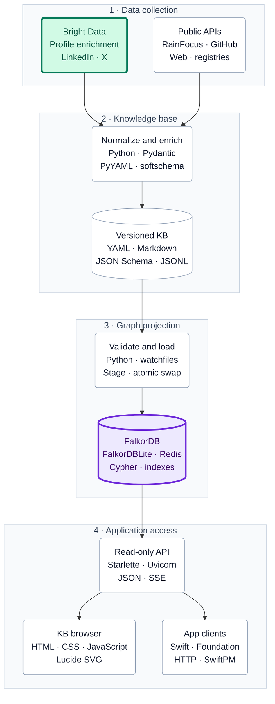

# Paraverse

Paraverse is being built as part of the
[Patch the Conference Hackathon](https://www.wemakedevs.org/hackathons/ptc?utm_source=luma),
hosted by Bright Data and WeMakeDevs ([event listing](https://luma.com/ptc)).

Paraverse assembles the public record of a conference into a knowledge base you can
browse. It covers sessions, speakers, people, organizations, repositories and packages.
Each entity has a structured YAML record, stored in a YAML file or as Markdown
frontmatter, so different editions and different conferences line up side by side.
Each record cites the sources it was built from.

The datasets cover GitHub Universe and the Patch the Conference Hackathon.

## Hackathon Demo

The project demonstrates three tools across the path from public sources to a connected
conference knowledge base:

| Tool | Role in Paraverse |
| --- | --- |
| Bright Data | Acquires public professional profile and organization data for the dataset’s enrichment pipeline, with source snapshots and provenance. |
| FalkorDB | Loads the knowledge base as a graph and runs Cypher queries behind the browser, API and CLI. |
| Qodo | Reviews pull requests against code quality rules and the repository’s public data policy. |

See the [hackathon demo guide](docs/hackathon-demo.md) for the integration details,
review evidence, dataset prerequisites and demo flow.

## Architecture

**Bright Data** supplies profile and company enrichment.
**FalkorDB** serves the connected knowledge base.
The dataset repository builds the records; Paraverse imports and serves them.

The diagram shows the implemented data path.
Full softschema validation is opt-in at import; source and privacy review remain
separate checks. See [softschema, sync and app access](docs/app-integration.md) for the
update flow and client integration, and the
[detailed graph architecture](docs/project/architecture/arch-2026-10-24-graph-database.md)
for the storage mapping.

## Developer Tools

| Tool | How it is used |
| --- | --- |
| **Qodo** | Pull-request code review and public-data-policy checks. |
| **tbd** | Git-native beads, plans, engineering guidelines and agent coordination. |
| **softschema** | Versioned record contracts, compiled JSON Schemas and artifact validation; also part of the data pipeline. |
| Git and GitHub | Versioned code and datasets, submodule pins, pull requests and reviews. |
| uv and Make | Component environments, locked dependencies and build/check commands. The producer uses `uv_build`; the graph package uses Hatchling. |
| pytest, Node.js and Swift tests | Python integration tests, JavaScript lifecycle checks and Swift client tests. |
| Ruff, basedpyright, codespell and Flowmark | Code checks, type checks, spelling and Markdown formatting. |

## Layout

- `db/`: paraverse-graph, which loads a knowledge-base dataset into FalkorDB and serves
  it through a read-only web browser, a JSON API and a CLI, with a Swift client in
  `db/clients/swift/`. It loads datasets using the supported entity kinds and
  graph-export format.
- `vendor/`: datasets mounted as git submodules, one per conference.
  `vendor/universe2026-md` is the GitHub Universe dataset
  ([universe2026-md](https://github.com/jlevy/universe2026-md)): softschema records,
  schemas and the crawl pipeline.
  `vendor/ptc2026-md` is the
  [Patch the Conference dataset](https://github.com/jlevy/ptc2026-md), with cited public
  profiles of the judges and host, professional work, organizations, schemas, graph
  exports and an offline build pipeline.

## Getting the Data

The datasets are git submodules.
Clone with `git clone --recurse-submodules`, or run `git submodule update --init` in an
existing clone.
The selected dataset revision must include a built `kb/` tree; initializing a checkout
alone does not create those outputs.

To browse the hackathon dataset, run `make install` and
`make load serve DATASET=ptc2026-md` from `db/`. Each dataset uses its own graph, so
loading the hackathon preserves the Universe graph.
The browser’s **Datasets** control can select either dataset or combine both in one
view. People retain their event roles and links in the combined graph.

You can also use a built KB from a separate dataset checkout: from `db/`, run
`make load serve KB=../path/to/kb`. See the
[demo prerequisites](docs/hackathon-demo.md#run-the-graph-demo) before loading it.

## Data Policy

Everything in this repository is public.
Read the [data policy](docs/data-policy.md) before adding or changing data.
To have your data removed, open an issue or contact a maintainer.

## Docs

Design docs, research and plans are indexed in [docs/README.md](docs/README.md).

## Contributing

Agents and humans follow [AGENTS.md](AGENTS.md).
Work is tracked with [tbd](https://github.com/jlevy/tbd), and records are validated with
[softschema](https://github.com/jlevy/softschema).

## License

[MIT](LICENSE)

<!-- This document follows common-doc-guidelines.md.
See github.com/jlevy/practical-prose and review guidelines before editing.
-->
