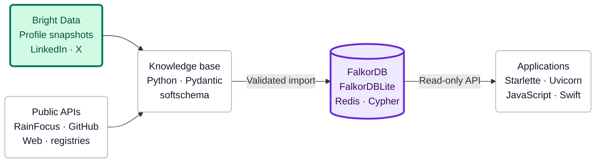

# Paraverse

**Video link:** [HERE](https://drive.google.com/file/d/1f7SpTgMJue6-KiPurrUpBdR2W75q_EMO/view)

Paraverse is being built as part of the
[Patch the Conference Hackathon](https://www.wemakedevs.org/hackathons/ptc?utm_source=luma),
hosted by Bright Data and WeMakeDevs ([event listing](https://luma.com/ptc)).

Paraverse assembles the public record of a conference into a knowledge base you can
browse. It covers sessions, speakers, people, organizations, repositories and packages.
Each entity has a structured YAML record, stored in a YAML file or as Markdown
frontmatter, so different editions and different conferences line up side by side.
Each record cites the sources it was built from.

The first conference covered is
[GitHub Universe](https://github.com/jlevy/universe2026-md#readme).
Its dataset pipeline crawls the official conference website and agenda, then enriches
identified accounts with public professional profiles, including Bright Data’s public
profile datasets. The
[dataset guide](https://github.com/jlevy/universe2026-md#sources-and-collection)
describes collection and offline rebuilding.

Paraverse imports the dataset’s graph and records into its database and serves a browser
for exploring them. See [db/README.md](db/README.md) for installation, dataset loading
and the browser; [curation/README.md](curation/README.md) covers reviewing additional
professional connections.

The datasets cover GitHub Universe and the Patch the Conference Hackathon.

## Hackathon Demo

The project demonstrates three tools across the path from public sources to a connected
conference knowledge base:

| Tool | Role in Paraverse |
| --- | --- |
| Bright Data | Acquires public professional profile and organization data for the dataset’s enrichment pipeline, with source snapshots and provenance. |
| FalkorDB | Loads the knowledge base as a graph and runs Cypher queries behind the browser, API and CLI. |
| Qodo | Reviews pull requests against code quality rules and the repository’s public data policy. |

See the [hackathon demo guide](docs/hackathon-demo.md) for the integration details,
review evidence, dataset prerequisites and demo flow.

## Architecture

**Bright Data** supplies profile and company enrichment.
**FalkorDB** serves the connected knowledge base.
The dataset repository builds the records; Paraverse imports and serves them.

| Layer | Technologies and role |
| --- | --- |
| Collection | **Bright Data** snapshot API for LinkedIn and X; Python `urllib`, HTML/XML parsing, RainFocus, GitHub and social APIs, websites and package registries. |
| KB build | Python, Pydantic, PyYAML and **softschema**; normalize identities, preserve source manifests, merge cited bios, and validate records. |
| Published artifacts | Git-versioned YAML and Markdown records, JSON Schema, graph/search JSONL, and JSON statistics. |
| Import and sync | Python, PyYAML and watchfiles; load a completed KB into a staging graph and replace the live graph atomically. |
| Graph database | **FalkorDB**, with FalkorDBLite locally; Redis, Cypher, typed IDs, relationship properties, indexes, stored schemas and load metadata. |
| API | Starlette and Uvicorn; JSON data reads, dataset selection, named queries, and server-sent events. |
| Browser | HTML, CSS, JavaScript ES modules and Lucide SVG icons. |
| App clients | HTTP; the existing Swift client uses Foundation `URLSession` and Swift Package Manager. |

The diagram shows the implemented data path.
Full softschema validation is opt-in at import; source and privacy review remain
separate checks. See [softschema, sync and app access](docs/app-integration.md) for the
update flow and client integration, and the
[detailed graph architecture](docs/project/architecture/arch-2026-10-24-graph-database.md)
for the storage mapping.

## Developer Tools

| Tool | How it is used |
| --- | --- |
| **Qodo** | Pull-request code review and public-data-policy checks. |
| **tbd** | Git-native beads, plans, engineering guidelines and agent coordination. |
| **softschema** | Versioned record contracts, compiled JSON Schemas and artifact validation; also part of the data pipeline. |
| Git and GitHub | Versioned code and datasets, submodule pins, pull requests and reviews. |
| uv and Make | Component environments, locked dependencies and build/check commands. The producer uses `uv_build`; the graph package uses Hatchling. |
| pytest, Node.js and Swift tests | Python integration tests, JavaScript lifecycle checks and Swift client tests. |
| Ruff, basedpyright, codespell and Flowmark | Code checks, type checks, spelling and Markdown formatting. |

## Layout

- `db/`: paraverse-graph, which loads a knowledge-base dataset into FalkorDB and serves
  it through a read-only web browser, a JSON API and a CLI, with a Swift client in
  `db/clients/swift/`. It loads datasets using the supported entity kinds and
  graph-export format.
- `vendor/`: datasets mounted as git submodules, one per conference.
  `vendor/universe2026-md` is the GitHub Universe dataset
  ([universe2026-md](https://github.com/jlevy/universe2026-md)): softschema records,
  schemas and the crawl pipeline.
  `vendor/ptc2026-md` is the
  [Patch the Conference dataset](https://github.com/jlevy/ptc2026-md), with cited public
  profiles of the judges and host, professional work, organizations, schemas, graph
  exports and an offline build pipeline.

## Getting the Data

The datasets are git submodules.
Clone with `git clone --recurse-submodules`, or run `git submodule update --init` in an
existing clone. The selected dataset revision must include a built `kb/` tree;
initializing a checkout alone does not create those outputs.

To browse the hackathon dataset, run `make install` and
`make load serve DATASET=ptc2026-md` from `db/`. Each dataset uses its own graph, so
loading the hackathon preserves the Universe graph.
The browser’s **Datasets** control can select either dataset or combine both in one
view. People retain their event roles and links in the combined graph.

You can also use a built KB from a separate dataset checkout: from `db/`, run
`make load serve KB=../path/to/kb`. See the
[demo prerequisites](docs/hackathon-demo.md#run-the-graph-demo) before loading it.

## Native App

The macOS app lives in `native/`, with a local profile and planning service in
`backend/`. It requires macOS 14 or later, Swift 6, Python 3.12 or later, and the uv
version selected by `db/uv.toml`.

1. Initialize datasets with `git submodule update --init`.
2. Run `make install` in `db/` to install the graph runtime.
3. Copy `.env.example` to `.env` and configure service credentials locally.
4. Start `python3 backend/profile_service.py` from the repository root.
5. Run `bash native/run-app.sh` from the repository root.
   The launcher rebuilds the app, closes packaged Paraverse copies, and opens
   `native/build/Paraverse Final.app`.

The landing page has a **Knowledge Base** button beside **Start**, available before
profile setup. Returning users open Discover, where they can choose a conference.
Opening GitHub Universe enters its conference world.
The top-right controls provide **Knowledge Base**, **Log Out**, and a Settings menu for
the profile, calendar, and app settings.
The Knowledge Base action opens an embedded browser.
The app starts the local graph browser on port 8766, selects both mounted datasets, and
watches rebuilds. Closing its window keeps a ready server warm for reopening; quitting
the app stops the server it started.
A separately running browser is reused and left running.
Keep the app in `native/build` or set `PARAVERSE_REPO_ROOT` to the repository folder.

Each app build exports native people, attendance evidence, session descriptions and
session cards from the pinned dataset KBs. `native/Assets/kb-native-manifest.json`
records their exact commits, graph digests, validation status and known gaps.
Softschema validation is reused only for the same clean dataset commits and digests.
An invalid or missing KB stops the build. The native interface uses these exported
snapshots; the embedded browser queries FalkorDB directly. Personal recommendations
are scoped to GitHub Universe, and public participation never implies matching consent.
External side events and broader conference discovery remain separately maintained.
The legacy optional cloud demo graph is not used for the current snapshot.

Run `swift test -c release --package-path native` and
`PYTHONPATH=db/src:backend db/.venv/bin/python -m unittest discover -s backend -p 'test_*.py'`.
Tests use public bundled data or synthetic records and require no account credentials.
Run `make check` from `db/` and `make lint-check test check` from `curation/` for their
own validation. The earlier standalone web preview remains in `ui/`.

## Data Policy

Everything in this repository is public.
Read the [data policy](docs/data-policy.md) before adding or changing data.
To have your data removed, open an issue or contact a maintainer.

## Docs

Design docs, research and plans are indexed in [docs/README.md](docs/README.md).

## Contributing

Agents and humans follow [AGENTS.md](AGENTS.md).
Work is tracked with [tbd](https://github.com/jlevy/tbd), and records are validated with
[softschema](https://github.com/jlevy/softschema).

## License

[MIT](LICENSE)

<!-- This document follows common-doc-guidelines.md.
See github.com/jlevy/practical-prose and review guidelines before editing.
-->
