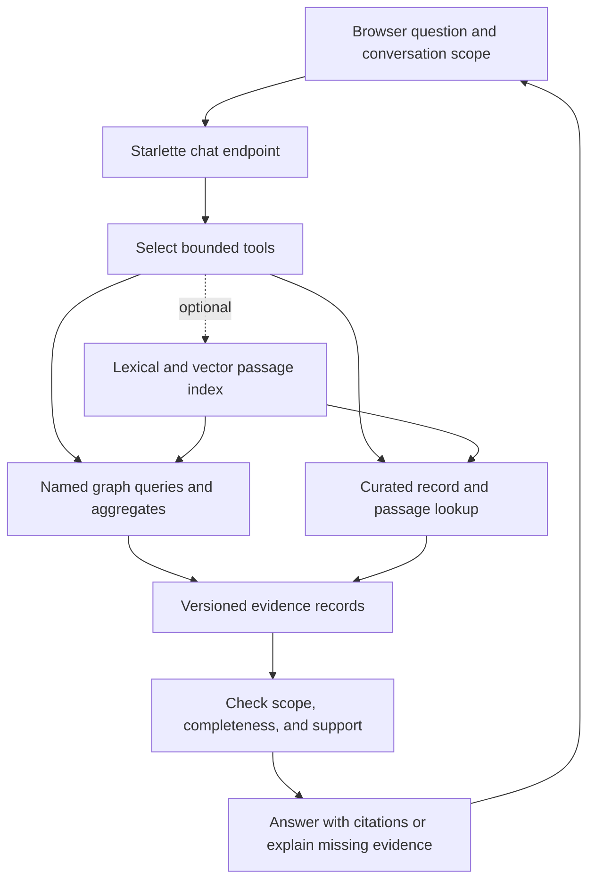

# Research: Chat over Graphs and Curated Source Files

**Date:** 2026-10-24 (last updated 2026-10-24)

**Author:** Joshua Levy, with LLM assistance

**Status:** Complete

## Overview

Paraverse can support questions across structured conference records and the prose that
explains them. The recommended starting point is **bounded graph tools with curated
source-file lookup**: use FalkorDB for exact filters, counts, and relationships;
retrieve YAML fields and Markdown passages for explanations and citations.

A graph is not required for a useful first chat interface.
A file-based agent can search and read the curated records directly, provided
deterministic code handles aggregation.
The existing graph and named queries make the combined approach a better fit here.
Add vector retrieval only when evaluation shows that lexical search misses relevant
passages. Full GraphRAG ingestion is a separate option with substantially more modeling
and synchronization work.

The target datasets are GitHub Universe, covering multiple editions, and Patch the
Conference Hackathon (PTC), with cross-dataset questions where evidence permits.
The [hackathon’s official site](https://www.wemakedevs.org/hackathons/ptc) describes its
program; the second dataset and combined view were added in
[PR #10](https://github.com/jlevy/paraverse/pull/10).

## Questions to Answer

1. Which questions need structured computation, passage retrieval, or both?
2. What can the current graph answer, and what source content does it omit?
3. Which FalkorDB APIs and frameworks reuse an existing graph?
4. How should answers preserve provenance, dataset scope, and source versions?

## Scope

“Source files” means curated Markdown records with YAML frontmatter, pure YAML records,
and explicitly included public documentation.
It excludes unreviewed crawl caches by default.
The [data policy](../../data-policy.md) applies to retrieval, generated summaries,
examples, and any later search index.

This design covers Python/Starlette integration, the browser, and provider choices.
Autonomous crawling, catalog mutation, inferred attendance, and contact lookup are
outside scope.

## Findings

### Current content and integration boundaries

The [graph architecture](../architecture/arch-2026-10-24-graph-database.md) and
[browser architecture](../architecture/arch-2026-10-24-kb-browser.md) provide the
baseline:

- [Artifact loading](../../../db/src/paraverse_graph/kb.py) reads YAML or frontmatter
  and selects the structured payload.
  It does not retain the Markdown body.
- [Mapping](../../../db/src/paraverse_graph/mapping.py) keeps the complete structured
  payload in the JSON-encoded `doc` string, promotes selected properties, and creates
  `search_text` from selected text fields and aliases.
  A field can be present in `doc` without being covered by global full-text search.
  Nested employment, education, or role evidence may also lack queryable graph
  properties; exact filters need validated payload scans or an explicit projection of
  the required fields.
- [Named queries](../../../db/src/paraverse_graph/queries.py) already cover entity
  lookup, schedules, topic sessions, affiliations, repositories, and bounded connecting
  paths. Their typed parameters are a useful tool boundary.
- [GraphReader](../../../db/src/paraverse_graph/browser.py) enforces read-only
  execution, a four-second query timeout, and NUL checks on parameters.
  It does not impose a universal row or byte cap.
  Some card queries have no result limit, so wrapping them for chat requires explicit
  budgets.
- [Load metadata](../../../db/src/paraverse_graph/loader.py) includes `load_id` and a KB
  digest. The digest described in the reader covers graph exports; it is not a substitute
  for hashing every source passage that a chat answer cites.

The browser currently obtains its record data from FalkorDB. Direct file retrieval
therefore needs an additional source resolver, particularly for a remotely hosted graph.
PR #10’s shared active-dataset selection also needs a chat boundary: each conversation
must pin its dataset and load version instead of inheriting a mutable global selection.

### Structured questions and passage questions

“How many sessions match this exact taxonomy term?”
needs an exhaustive filtered count.
“How is this speaker connected to that project?”
needs identity-aware traversal.
These can be computed from parsed YAML references or a graph; FalkorDB makes the latter
convenient.

“What trade-offs does the abstract describe?”
needs the actual passage.
“Find talks about deployment difficulties even when they use different wording” benefits
from semantic retrieval.
“Of those talks, which occur after lunch?”
combines passage discovery with exact event and time filtering.

Top-k retrieval cannot establish a global count, prove that no matching record exists,
or make a complete list.
Semantic categories also need an explicit definition before an exhaustive count is
meaningful. Label a ranked selection as a selection.

[Softschema](https://github.com/jlevy/softschema) supplies contracts, field
descriptions, envelopes, and validation status for Markdown/frontmatter and pure YAML
records. It is a parser and schema boundary, not a language model or retrieval engine.
YAML remains authoritative for consumed structured values; Markdown carries context and
caveats. A chat reader may quote that prose without silently turning it into
authoritative schedule or participation fields.

### Native search APIs

FalkorDB provides full-text indexing through `db.idx.fulltext.createNodeIndex` and
retrieval through `db.idx.fulltext.queryNodes`. Search results can feed ordinary Cypher
filters and graph traversal.
[Full-text documentation](https://docs.falkordb.com/cypher/indexing/fulltext-index)

Vector indexing uses `CREATE VECTOR INDEX`, with a declared dimension and distance
function; vectors use `vecf32`. The query procedures are `db.idx.vector.queryNodes` and
`db.idx.vector.queryRelationships`. Embeddings must come from a separate model.
[Vector documentation](https://docs.falkordb.com/cypher/indexing/vector-index)

The Python client exposes `ro_query(q, params, timeout)`. The database rejects writes
through `GRAPH.RO_QUERY`, making it the execution boundary for any generated query.
[Python API](https://falkordb-py.readthedocs.io/en/latest/falkordb.html),
[read-only command](https://docs.falkordb.com/commands/graph.ro-query)

## Comparison Matrix

Effort estimates include integration and evaluation against the current application.

| Option | Exact counts and joins | Prose coverage | Main cost or limitation | Fit |
| --- | --- | --- | --- | --- |
| A. Curated-file tools | Deterministic scans and reference joins | All allowed fields and bodies | Build record catalog and joins; lexical recall limits | Useful baseline |
| B. Graph tools with file lookup | Existing graph and named queries | Full records and selected passages | Version alignment and bounded tool responses | Recommended first |
| C. Hybrid file index joined to graph | Graph after retrieval; explicit exhaustive tools for totals | Lexical and semantic passages | Embedding, chunking, updates, relevance evaluation | Add when recall warrants |
| D. General text-to-Cypher | Flexible, if generated query is correct | Only graph-visible content unless paired with files | Query correctness, limits, schema guidance | Later controlled experiment |
| E. Full SDK GraphRAG ingestion | Queries over its projected graph | Ingested documents and extracted facts | Another schema, identity resolution, embeddings, reconciliation | Separate document-heavy use case |

## Options Considered

### A. Agent with curated-file tools

Expose a record catalog, schema lookup, field filtering, lexical search, and bounded
record or Markdown-section reads.
Parse YAML safely and resolve references by typed ID. For counts, execute code over the
complete scoped catalog; the model selects a typed operation and explains its result.

This covers fields omitted from `search_text` and bodies absent from the graph, without
embeddings. Reuse the portable artifact reader and contracts.
The model receives scoped search/read/query tools, not a shell.
Cross-record joins and snapshot management remain application work.

### B. Graph tools with source-file lookup

Use named graph tools for structured work and add source tools for omitted text,
field-level evidence, and surrounding context.
A source resolver maps dataset, typed ID, and `kb_path` to an allowed record at the
pinned version.

For example, retrieve sessions by a taxonomy term, resolve their speakers and
organizations, then read the relevant abstracts to explain the selection.
Keep structured filters deterministic, adding aggregate tools or full-payload scans
where the catalog lacks them.

Distinguish an absent field, an unavailable source body, and a failed query.

### C. Hybrid retrieval over files joined to graph IDs

Build a lexical and optional vector index from approved prose fields and Markdown
sections. Each hit retains its dataset, record ID, field path or heading, and source
version. Resolve those IDs against the graph for affiliations, schedule constraints, and
follow-up questions.

Chunk by record and section boundaries.
Keep short abstracts together; split long bodies by heading with bounded overlap.
Keep records separate, carry field labels, and distinguish source text from generated
summaries.

FalkorDB can store these embeddings, avoiding a second database.
Alternatively, a separate file index can return IDs for graph joins.
Exact scope filters must be applied deliberately: post-filtering only the first few
semantic hits can miss qualifying records.
A bounded candidate search must report truncation; exhaustive questions need a different
operation.

The official Python integration supports `FalkorDBVector.from_existing_graph` and hybrid
search. This is an adaptation aid, not a requirement.
[LangChain integration](https://github.com/FalkorDB/langchain-falkordb)

### D. General text-to-Cypher

FalkorDB’s [text-to-cypher service](https://github.com/FalkorDB/text-to-cypher) provides
schema discovery, conversation history, retries, and REST/MCP interfaces.
Its Python guide documents `POST /text_to_cypher` with `cypher_only: true`, so the
application can validate and execute the returned query itself.
[Python usage](https://github.com/FalkorDB/text-to-cypher/blob/master/docs/PYTHON_USAGE.md)

The Python `FalkorDBQAChain` offers a similar question-to-query-to-answer path.
Its explicit `allow_dangerous_requests` opt-in is a reminder to enforce database
permissions and query bounds rather than trusting generation.
[QA chain](https://github.com/FalkorDB/langchain-falkordb)

This expands question coverage, but wrong joins, direction, event scope, or distinctness
can produce plausible answers.
The model needs the actual schema and examples of multi-slot sessions and participation
semantics. General Cypher still cannot retrieve Markdown bodies that were never loaded.

### E. Full GraphRAG SDK ingestion

The SDK’s async `GraphRAG` interface exposes `ingest`, `retrieve`, and `completion`,
with conversation history, returned context, and custom retrieval strategies.
[API reference](https://docs.falkordb.com/graphrag/api-reference)

Default retrieval assumes its document/chunk provenance model, `__Entity__` labels,
embeddings, and `RELATES` edges whose properties describe the relationship.
Adapting an existing independently modeled graph therefore requires a custom strategy or
another maintained projection.
[Architecture](https://docs.falkordb.com/graphrag/architecture),
[storage](https://docs.falkordb.com/graphrag/storage)

The latest release observed was v1.5.0. The v1 API and graph format replaced v0, so
older `KnowledgeGraph.ask` examples are unsuitable implementation references.
The current README requires FalkorDB 4.20 or later; the associated dataset investigation
observed embedded engine 4.18.3. That compatibility gap must be resolved before an SDK
spike. Pin and verify both versions.
[Releases](https://github.com/FalkorDB/GraphRAG-SDK/releases),
[requirements](https://github.com/FalkorDB/GraphRAG-SDK)

SDK inference uses separate LLM and embedding interfaces, with LiteLLM, OpenRouter, and
custom providers. Self-hosting FalkorDB does not make those calls local.
[Providers](https://docs.falkordb.com/graphrag/providers) Its connection configuration
is host/port based, whereas the native Python client supports Unix sockets used by
embedded deployments.
[SDK connection](https://github.com/FalkorDB/GraphRAG-SDK/blob/main/graphrag_sdk/src/graphrag_sdk/core/connection.py),
[native client](https://github.com/FalkorDB/falkordb-py/blob/main/falkordb/asyncio/falkordb.py)

Use this option when extracting new graphs from substantial document collections is
itself valuable. Re-extracting curated conference facts adds identity and provenance
reconciliation that the initial chat does not need.

## Recommendations

### Retrieval and evidence architecture

Keep model credentials in the backend.
A hosted model is the simplest initial integration; local inference is an alternative to
evaluate against the same questions.
Store bounded conversation history separately from the catalog.
Follow-ups should retain resolved entity IDs and scope, not depend only on prior
generated prose.

Every evidence record should identify dataset, record ID, repository-relative path, YAML
field path or Markdown heading/span, file hash or commit, and graph `load_id` and digest
when applicable. Retain original public source URLs and retrieval timestamps.
The browser can link both to its entity view and to a versioned source record.

Pin the corpus manifest and graph load for a conversation.
Check versions before and after multi-tool retrieval.
If a load or active dataset changes, discard mixed results and retry against a
consistent snapshot or reset the conversation scope.
Hash source bodies as well as graph exports.
A graph ID alone cannot establish that a citation matches the record version used for
the answer.

### Bounds and answer correctness

Set limits on tool calls, traversal depth, rows, serialized bytes, passage size, and
total model context.
Bound database work and returned data before serialization; a four-second timeout alone
is insufficient. Preserve total counts separately from paginated evidence, and report
truncation.

Treat all retrieved text as untrusted data.
Permit source reads only inside explicitly registered curated roots; resolve symlinks
and reject escaping paths.
Keep dataset selection, credentials, and file paths under application control.

Citations must reference evidence actually returned by tools.
Separate source assertions from model synthesis, show conflicting claims with their
dates and sources, and do not resolve a disagreement merely by choosing the
higher-ranked passage.
Missing affiliation or participation data does not imply absence.
For unsupported answers, state the missing evidence.

The SDK itself documents prompt-level abstention, application-owned claim verification,
and limitations in metadata filtering.
Its retrieval context is useful evidence, but these policies still belong in the
application.
[Grounding reference](https://docs.falkordb.com/graphrag/reliability-and-grounding)

## Evaluation Questions

These are test prompts, not claims that matching records exist.
Establish expected answers from the pinned curated sources, including explicit
“insufficient evidence” cases.

| Question | Required evidence or behavior |
| --- | --- |
| How many GitHub Universe sessions are recorded for each edition? | Exact distinct count and edition scope |
| Which Universe sessions on a selected day match a chosen taxonomy term? | Term identity, schedule slots, speakers |
| Which people have confirmed participations in both datasets? | Explicit participation evidence and identity resolution |
| Which PTC judges have public work related to a selected technology? | Published role plus cited work; no inferred attendance |
| How is a selected speaker connected to a repository through recorded relationships? | Bounded, labeled path with source records |
| Which organizations are recorded as sponsors of each event? | Event-scoped sponsorship and explicit missing coverage |
| Which abstracts discuss deployment trade-offs without using that exact phrase? | Relevant passages, ranked selection |
| What caveats appear in a selected record’s Markdown body? | Body retrieval, heading and version citation |
| Which YAML field supports this answer, and what does its contract mean? | Field path, value, contract description |
| Of those sessions, which start after lunch on the selected day? | Follow-up IDs, explicit cutoff and time zone |
| Do two source passages disagree about a role or session detail? | Both versions, dates, conflict acknowledged |
| Answer the previous question after switching datasets or reloading the graph. | No mixed snapshots; reset or retry visibly |

Score structured answers against deterministic expected results.
For prose, review retrieval coverage, claim support, citation accuracy, and appropriate
abstention. Track latency, token cost, truncation, and reload behavior.
Include adversarial source text and ambiguous names without publishing private fixtures.

## Next Steps and Open Questions

The following are engineering estimates for one developer familiar with the application,
not measured commitments.

| Phase | Deliverable and decision | Estimated effort |
| --- | --- | --- |
| 0 | Inventory searchable fields and bodies; establish versioned evaluation cases | 1–2 days |
| 1 | Option B with bounded tools, source resolver, chat UI, citations, and reload checks | 3–5 additional days |
| 2 | Compare lexical and hybrid retrieval; adopt embeddings only for demonstrated recall gains | 2–4 additional days |
| 3 | Compare general Cypher or SDK projection against remaining failures | 3–5 days for Cypher; 1–2 weeks for an SDK projection experiment |

Before implementation, settle provider budget and locality requirements, actual
body/source coverage, which fields may reach hosted models, and how remote deployments
obtain the matching source snapshot.
Cross-dataset identity should preserve unresolved matches.
Choose those policies from the evaluation and deployment needs; they do not prevent a
local prototype with bounded public records.

## Methodology and References

Research combined local source and architecture inspection with official FalkorDB,
GraphRAG SDK, LangChain integration, and softschema documentation on 2026-10-24. Links
appear beside the supported findings.
No model benchmark, installation, or application integration was run.
Framework fit and effort estimates are engineering judgments.

Check version-specific claims against pinned packages: current documentation contains
transitional naming, and development-branch examples can differ from releases.

<!-- This document follows common-doc-guidelines.md.
See github.com/jlevy/practical-prose and review guidelines before editing.
-->
