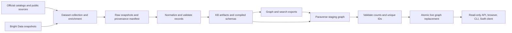

# Graph, Migration, and Demo Readiness Review

Date: 2026-10-24. Audit: `pv-67zv`.

Paraverse can load and browse the original GitHub Universe KB, but the selected dataset
submodule does not contain that KB. The running browser on port 8766 is the older
common-ground application.
Neither fact establishes that a new clone can run the current Paraverse demo.

This review pins Paraverse `6fc8c397`, original common-ground `2d42d861`, Universe
candidate `kb/data` at `795a50ad`, and dataset submodule `a803714e`. Other agents
changed the shared checkout during the audit, so runtime tests used an isolated copy of
the pinned source. These results describe those revisions rather than every open branch.
A second frozen run also checked the subsequent Paraverse revision `93934f3e`, including
its reload-cache fix.

## Follow-Up: Overview and a New Dataset Snapshot

The Overview integration was checked separately at Paraverse `818f6c6`, using Universe
KB snapshot `c6b4faa9`. The earlier audit tables below retain their original revisions
and counts.

| Follow-up check | Result |
| --- | --- |
| Full graph-component check | Lint and type checks passed; 134 tests passed, no skips |
| Artifact validation | All 5,092 artifacts valid |
| Isolated FalkorDB import | 5,522 entities, 25,544 relationships, 18 entity kinds, 41 relationship types |
| Browser summary | Live totals match the imported graph; source, coverage and quality tables available |
| Header alignment | Organization title and row tally share a text baseline |
| Focused integration review | No actionable findings in lifecycle, load identity or response-shape integration |

These results establish structural and runtime behavior for that snapshot.
They do not establish full data parity with common-ground or certify every record.
The different counts reflect different dataset revisions; a smaller total alone says
nothing about whether removals or identity changes were correct.

Further dataset reviews identified privacy and semantic-quality gaps after this run.
Those fixes and the final dataset rebuild remain separate work.
The Overview displays quality findings and coverage gaps for whichever graph is loaded;
passing schema validation does not clear them.

The updated local preview uses port 18866 and that tested snapshot.
Like the earlier preview, it is temporary and does not establish that the default
submodule in a new clone contains a releasable KB. Integration and PR work are tracked
in `pv-ixhd`.

## Readiness and Validation

| Check | Result |
| --- | --- |
| Pinned Paraverse lint, formatting, and type checks | Passed |
| Python tests at `6fc8c397` with original KB supplied explicitly | 113 passed, no skips |
| Python tests and lint at subsequent `93934f3e` | 114 passed, no skips; lint passed |
| Swift client at `93934f3e` | Four tests passed, no failures |
| Original KB artifact validation | All 5,401 artifacts valid |
| Isolated FalkorDB load | 5,831 entities, 26,377 relationships, 43 relationship types; no load problems |
| Current-code browser preview | Port 18766; home, entity tables, search, records, and connecting paths exercised |
| Default dataset in a new clone | Blocked: pinned submodule has no `kb/` |
| Existing browser on port 8766 | Older common-ground `cg-graph`, with original export; connecting paths unavailable |
| Repository CI | No workflow at the audited revision; eight open Paraverse PRs have no check results |

The graph load used FalkorDB 4.18.3 and took about two seconds after validation.
The preview on port 18766 is a local audit process using an isolated database and the
original KB. Its availability lasts only while that process runs; it is not a deployed
or migrated dataset.
Port 8766 was left untouched.

With the default dataset absent, real-graph tests skip through `tests/kb_graph.py`. A
green test command with those skips does not establish end-to-end readiness.
The isolated test run supplied the original KB to exercise those tests.
`COLUMNS=240` avoided a CLI diagnostic test failure caused by Rich wrapping a long
scratch pathname.

## From Source Data to Browser

The dataset producer collects and normalizes data.
Bright Data supplies additional public professional profile and organization information
through paid scraper snapshots.
The original collector triggers a job, polls its status, downloads records, and stores
retrieval evidence. Official conference catalogs and other enrichment sources are
separate inputs. Network collection and paid enrichment are distinct from loading an
already-built KB.

The dataset build creates structured YAML or Markdown-frontmatter records, compiled
softschema contracts, `_graph/nodes.jsonl`, `_graph/edges.jsonl`, `_graph/stats.json`,
and search documents.
Raw snapshot manifests record source URLs, retrieval times, and hashes.
A rebuild of the latest sanitized pipeline remains necessary before its output can be
certified: that pipeline revision differs from the one underlying the candidate KB.

Paraverse reads these files; it does not crawl or edit the dataset.
FalkorDBLite starts an embedded Redis server with the FalkorDB module and stores its
graph in an RDB file.
An explicit `--url` selects a remote server.
Each dataset has a separate named graph; the default name is `universe2026_md`.

See [the component guide](../../../db/README.md),
[graph architecture](../architecture/arch-2026-10-24-graph-database.md), and
[browser architecture](../architecture/arch-2026-10-24-kb-browser.md).

## Graph Structure

Each entity listed in the graph export becomes an `Entity` node with a kind-specific
label. People can also carry role labels such as `Speaker`, `Attendee`, `Organizer`, or
`Volunteer`; organizations can carry `Sponsor`; accounts also carry `Account`.

| Primary kind | Original/live export | Candidate export |
| --- | ---: | ---: |
| Day | 14 | 14 |
| Event | 4 | 4 |
| Experience | 11 | 11 |
| Facet | 34 | 34 |
| GitHubAccount | 258 | 250 |
| Organization | 336 | 329 |
| Package | 146 | 140 |
| Page | 9 | 9 |
| Person | 590 | 579 |
| Profile | 590 | 579 |
| Repository | 1,286 | 1,227 |
| Room | 85 | 85 |
| Session | 520 | 520 |
| SocialAccount | 1,161 | 1,102 |
| Software | 61 | 61 |
| Term | 418 | 418 |
| Venue | 64 | 64 |
| Website | 244 | 226 |
| **Total** | **5,831** | **5,652** |

Nodes carry `id`, `entity_kind`, `display_name`, `kb_path`, `search_text`, promoted
query properties, and the full structured payload as JSON in `doc`. Days and terms are
nested inside event and facet artifacts.
Markdown bodies, raw snapshots, the standalone search export, and coverage reports are
not copied into FalkorDB.

The graph also contains one `Schema` node per loaded compiled kind and one `GraphMeta`
node with dataset identity, export digest, load timestamp, and counts.
These are additional metadata nodes, outside the entity counts above.

All 43 observed relationship types are listed below.
A type can occur between several kinds, so some names repeat across rows.

| Source and target | Relationship types |
| --- | --- |
| Session to Event, Day, or Room | `PART_OF`, `SCHEDULED_ON`, `HELD_IN` |
| Session to Term | `HAS_TYPE`, `HAS_LEVEL`, `IN_TRACK`, `ABOUT_TOPIC`, `FEATURES_PRODUCT`, `FOR_AUDIENCE`, `FOR_INDUSTRY`, `DELIVERED_AS`, `IN_CURATED_AGENDA` |
| Session to Session | `RELATED_TO` |
| Person to Session, Event, or Organization | `PRESENTS`, `PARTICIPATES_IN`, `AFFILIATED_WITH` |
| Person to account or Website | `HAS_ACCOUNT`, `HAS_WEBSITE` |
| Person to Term or Software | `EXPERT_IN`, `WORKS_WITH` |
| Person to Repository | `MAINTAINS`, `PINS`, `CONTRIBUTES_TO` |
| Person or Organization to Package | `PUBLISHES` |
| Person or Session to Organization or Software | `MENTIONS` |
| Profile to Person | `DESCRIBES` |
| Organization to Session, Event, or Software | `HOSTS`, `ORGANIZES`, `SPONSORS`, `MAKES` |
| Organization to account or Organization | `HAS_ACCOUNT`, `RELATED_TO` |
| Event to Day, Venue, or Person | `HAS_DAY`, `LOCATED_AT`, `FEATURES` |
| Room or Experience to Venue; Venue to Venue | `LOCATED_IN`, `PART_OF` |
| Facet to Term | `HAS_TERM` |
| GitHubAccount to Repository | `OWNS`, `PINNED`, `TOP_REPOSITORY`, `CONTRIBUTES_TO` |
| GitHubAccount to Website or SocialAccount; Website to SocialAccount | `LINKS_TO` |
| Repository to Software | `SOURCE_OF` |
| Package to Repository or Software | `PUBLISHED_FROM`, `DISTRIBUTES` |
| Software to Term | `CATALOG_TERM` |

Relationships preserve attributes such as role, source basis, sponsor tier, account
match, dates, and slot starts.
Nested attributes are serialized to JSON properties.

The loader creates ID indexes, selected filter indexes, full-text indexes for entities,
sessions, and people, and a unique constraint on `Entity.id`. It does not enforce the
whole softschema contract as database constraints.
Named read-only queries support statistics, entity lookup, neighborhoods, search, days,
schedules, sessions by term, people and organization cards, repositories, similar
people, connecting paths, sponsors, software, and taxonomy.
Path queries use one to three hops and exclude event/day/facet hubs.
People similarity restricts suggested candidates to people published by the event.

## How Imports Are Published

1. Resolve `--kb`, `--dataset`, `PARAVERSE_KB`, or the default submodule.
2. If requested, validate all KB artifacts against their declared softschema contracts
   and maturity status with `load --validate`.
3. Capture filesystem metadata before reading the exports and artifacts, to detect
   changes during loading.
4. Read the graph export and referenced artifacts; check envelope kinds and nonempty
   contract declarations.
5. Create a unique staging graph; import entities and relationships in batches.
6. Build indexes, compare actual per-kind and per-relation counts with `stats.json`,
   reject duplicate entity IDs, load schemas, and establish the unique-ID constraint.
7. Recheck the source snapshot, atomically replace the live graph with Redis `RENAME`,
   then publish a `graph.loaded` notification.

Failures before replacement preserve the live graph.
A notification failure after replacement currently raises despite a successful
replacement; this needs separate handling (`pv-1d0v`). Manual failed loads retain
staging for inspection; watch-mode failures clean up their staging and retry with
backoff.

The KB producer must publish complete builds atomically.
Routine imports check contracts are named, but only `--validate` runs their full
softschema validation.
The producer’s additional model and semantic checks remain a separate responsibility.

The export digest is SHA-256 over node and edge export bytes, truncated to 16 hex
characters. It does not hash artifact payloads or compiled schemas.
Matching this digest proves matching export bytes, rather than complete build identity.

## Migration Completeness and Data Quality

| Snapshot | Entities | Relationships | Search documents |
| --- | ---: | ---: | ---: |
| Original common-ground `2d42d861` | 5,831 | 26,377 | 5,207 |
| Universe candidate `795a50ad` | 5,652 | 26,030 | 5,039 |
| Selected submodule `a803714e` | No KB | No KB | No KB |

The selected submodule has only `.gitignore` and `LICENSE`. Universe checkout `4101f7a`
has setup and docs; the candidate KB and pipeline are on other branches.
The live original export digest is `31b8ac63b9387eca`; the candidate is
`c5f559dbd2a62992`.

The candidate preserves all 520 session payloads and all 578 speaker IDs.
Event, room, venue, facet, software, experience, and page payloads also match.
All 791 presentation, 528 schedule, 528 room, 54 sponsor, and 81 host relationships
match. Repeated catalog rows are normalized; the session totals account for all four
editions, 2023–2026.

Both exports have unique IDs, correct declared counts, no dangling edge endpoints, no
missing referenced artifacts, and expected search coverage plus 14 FAQ entries.
Both raw manifests have 45 entries, with all referenced files present and hashes valid.
These checks establish structural integrity for those two snapshots.

Person migration remains incomplete.
Twelve original non-speaker IDs disappear, and one person returns under a different
identity, leaving eleven people absent and one renamed.
Their original records cite public self-reported attendance evidence, so these omissions
require explicit reconciliation against the data policy.
Smaller account, website, organization, package, and repository counts include both
intentional filtering and consequences of the attendance changes; each omission has not
been individually certified as a policy exclusion (`pv-lyte`).

The candidate has 578 brief bios for 579 people; eight bios are marked stale.
It has 120 social accounts whose details have not been fetched.
Expertise appears in 556 profiles, while interests appear in 572. Coverage percentages
alone are misleading: rounded bio coverage reads 100%, and 100% presence of
`details_fetched` does not mean that every value is true.
Exact counts and stale flags belong in completeness reports (`pv-923x`).

The original/live dataset produces 621 heuristic quality findings: 26 assigned blocker,
91 high, 407 medium, and 97 low.
Findings overlap and are not counts of unique affected records.
Checks flag employer/title bio mismatches, organization identity ambiguities, contact
information in text, incomplete program data, and graph inconsistencies.
A structurally valid import does not resolve these semantic findings.
Each needs triage (`pv-ncno`); the old dataset’s results do not certify the sanitized
candidate.

## Open Findings and Setup Work

| Priority | Finding and bounded next step | Bead |
| --- | --- | --- |
| High | Land a reproducibly built, reviewed dataset, advance the submodule pin, and prove a clean-clone default load | `pv-3rk4` |
| High | Export per-slot end times and query them; seven sessions repeat and currently receive the latest end for every slot | `pv-ubtd` |
| High | Add CI using the verify command and require real-KB integration coverage instead of accepting missing-data skips | `pv-m1yp` |
| High | Reconcile attendance identities and stale/missing bios in the dataset repository | `pv-lyte` |
| Medium | Reject exported node IDs that do not resolve inside their referenced artifact; the current fallback can publish an empty payload | `pv-3adh` |
| Medium | Require compiled schemas for every loaded kind before replacement; otherwise browser kinds can disappear | `pv-40ee` |
| Medium | Include the 125 pinned-repository relationships in the query that promises maintained or pinned repositories | `pv-4r0d` |
| Medium | Distinguish replacement success from notification failure | `pv-1d0v` |
| Medium | Show exact fetched, missing, and stale coverage counts | `pv-923x` |

The README, component guide, architecture docs, and docs index provide an orientation
path. The architecture doc’s graph-name examples were corrected to `universe2026_md`.
Review also found several missing common-doc footers, and no repository Markdown
formatting command or hook (`pv-9ar9`). The hackathon documentation adds the project
context and technology roles; these setup items should be reconciled when integrating
the stacks.

`tbd doctor` recognizes current installed integrations, while effective policy grants on
the fetched default branch lag the proposals in the working branch.
Several agent hook fixes are already tracked.
Sandbox restrictions on `.git` required elevated tbd commands for bookkeeping; that
failure was environmental rather than evidence of broken repository permissions.

Qodo PR review is configured and existing review findings are tracked, but local Qodo
standards could not be loaded in this session: the CLI had no cached catalog or
installed skills and required browser authentication.
The sign-in flow was started; local checks continued without claiming a Qodo review.

The active graph-hardening plan also leaves topic-resolution queries, list parameters,
evidence-weighted ranking, remote deployment, and a second-conference namespace strategy
unfinished. They are not prerequisites for the tested local table/search demo.

<!-- This document follows common-doc-guidelines.md.
See github.com/jlevy/practical-prose and review guidelines before editing.
-->
